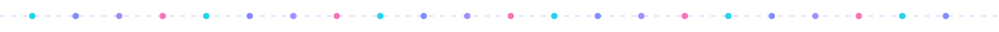
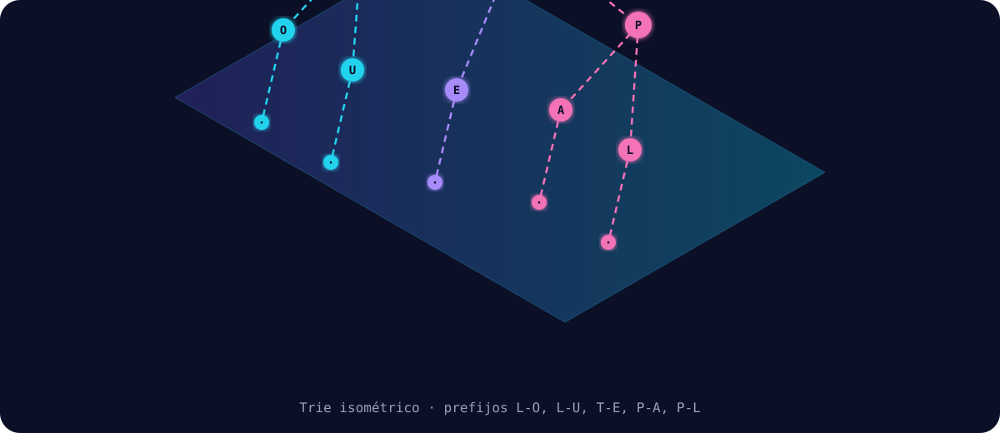
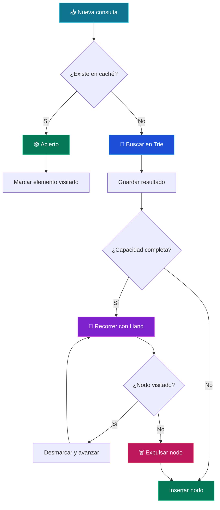
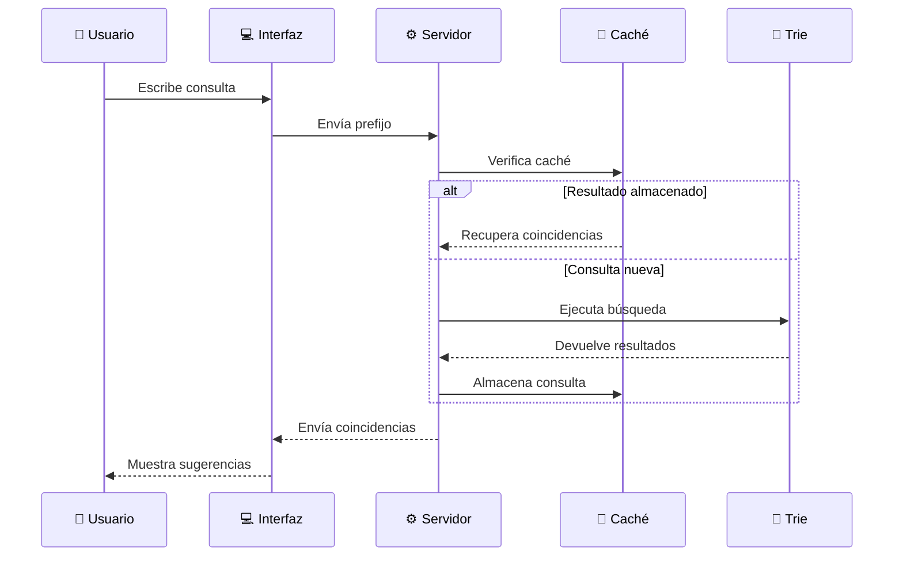

<div align="center">


<a href="#-03--núcleo-del-sistema">

</a>

**Carrera de Computación · Tercer Ciclo · Estructura de Datos · Grupo 4**

[](#-03--núcleo-del-sistema)
[](#-04--gestión-inteligente-de-caché)
[](#-05--flujo-de-búsqueda)
[](#-05--flujo-de-búsqueda)


<sub>Septiembre 2026 — Febrero 2027 · Loja, Ecuador</sub>

</div>



## 📑 Contenido

| | | |
|:--|:--|:--|
| [01 · Presentación](#-01--presentación-del-proyecto) | [02 · Interfaz](#-02--interfaz-de-exploración) | [03 · Núcleo 3D](#-03--núcleo-del-sistema) |
| [04 · Caché](#-04--gestión-inteligente-de-caché) | [05 · Flujo](#-05--flujo-de-búsqueda) | [06 · Rendimiento](#-06--experimentación-y-rendimiento) |
| [07 · Loja en imágenes](#-07--loja-en-imágenes) | [08 · Estado y ejecución](#-08--galería-y-estado-de-desarrollo) | [09 · Equipo](#-09--equipo-de-desarrollo) |


<div align="center">

## 🩵 01 · PRESENTACIÓN DEL PROYECTO


</div>

El **Autocompletado Turístico de las Artes Vivas de la Ciudad de Loja** es una aplicación que facilita la exploración de lugares, obras y eventos culturales mediante un buscador dinámico capaz de generar sugerencias mientras el usuario escribe.

El sistema aplica estructuras de datos y algoritmos para mejorar la recuperación de información, disminuir búsquedas repetitivas y estudiar el comportamiento de las consultas mediante un sistema de almacenamiento temporal en caché.

### ✦ Objetivos del sistema

- 🎭 Facilitar el descubrimiento de lugares y eventos turísticos y culturales.
- 🌳 Implementar búsqueda por prefijos mediante un árbol Trie.
- ⚡ Optimizar la recuperación de consultas repetidas mediante caché.
- 🔗 Aplicar listas doblemente enlazadas en la administración de memoria.
- ⚖️ Comparar diferentes políticas de reemplazo.
- 📈 Analizar el comportamiento y rendimiento de las estructuras implementadas.

<div align="center">


<sub>Figura 1. Interfaz principal del autocompletado turístico.</sub>

</div>


<div align="center">

## 💜 02 · INTERFAZ DE EXPLORACIÓN


</div>

La interfaz permite ingresar nombres o fragmentos de palabras para localizar información cultural y turística de Loja. A medida que se introduce texto, el sistema procesa la consulta y presenta coincidencias disponibles.

| Funcionalidad | Descripción |
|---|---|
| 🔎 **Autocompletado** | Generación dinámica de sugerencias. |
| 🔤 **Búsqueda por prefijo** | Localización a partir de caracteres iniciales. |
| ⚡ **Respuesta dinámica** | Actualización de resultados durante la escritura. |
| 🗂️ **Consulta de catálogo** | Exploración de lugares, obras y eventos. |
| 🩺 **Estado del sistema** | Información sobre el estado de procesamiento. |

<div align="center">


<sub>Figura 2. Generación de sugerencias a partir de una consulta parcial.</sub>

</div>


<div align="center">

## 💠 03 · NÚCLEO DEL SISTEMA


### 🧊 Trie en 3D



<sub>Figura 3. Trie en vista isométrica animada: cada nivel agrega un carácter del prefijo.</sub>

<br/>

**Modelo 3D interactivo** → [`assets/modelo3d/trie.stl`](assets/modelo3d/trie.stl)
<br/>
<sub>GitHub abre archivos <code>.stl</code> con un visor 3D: arrastra para rotar, rueda para acercar.</sub>

</div>

El funcionamiento del proyecto se apoya en estructuras de datos que trabajan conjuntamente para organizar las consultas y gestionar los resultados recuperados.

| 🌳 Árbol Trie | ⚡ Tabla Hash (Map) | 🔗 Lista doblemente enlazada |
|:--|:--|:--|
| Organiza las palabras mediante caracteres compartidos y recorre únicamente la secuencia del prefijo consultado. | Localiza elementos por clave, dando acceso rápido a la información y referencias del sistema. | Nodos con referencia al anterior y al siguiente: permite mover y eliminar sin recorrer toda la estructura. |

### Relación entre las estructuras


<div align="center">

## 🟢 04 · GESTIÓN INTELIGENTE DE CACHÉ


</div>

La caché conserva resultados de búsquedas anteriores para reutilizarlos en consultas repetidas. Debido a su capacidad limitada, el sistema decide qué elementos permanecen y cuáles se reemplazan.

| Política | Nombre | Criterio de expulsión |
|:--:|---|---|
| 🟧 **FIFO** | Primero en entrar, primero en salir | Sale el más antiguo, sin importar su uso posterior. |
| 🟪 **LRU** | Menos recientemente utilizado | Se conservan los elementos consultados hace poco. |
| 🟦 **SIEVE** | Marcado y barrido | Marcas de visita y un puntero (*hand*) que recorre la lista para elegir qué expulsar. |

### Funcionamiento conceptual de SIEVE



<div align="center">


<sub>Figura 4. Administración de elementos y mecanismo de reemplazo de caché.</sub>

</div>


<div align="center">

## 🟠 05 · FLUJO DE BÚSQUEDA


</div>

La consulta se procesa, se verifica su disponibilidad en caché y, si no existe, se ejecuta la búsqueda sobre el Trie.



### Análisis de operaciones

| Operación | Estructura | Complejidad esperada |
|---|---|:--:|
| Recorrido de prefijo | Trie | `O(L)` |
| Acceso a clave | Map | `O(1)` prom. |
| Inserción local | Lista doble | `O(1)` con referencia |
| Eliminación local | Lista doble | `O(1)` con referencia |
| Recuperación de coincidencias | Trie | Depende del nº de resultados |
| Búsqueda en caché | Map | `O(1)` prom. |

<sub>L = longitud del prefijo ingresado. La recuperación completa también depende del número de coincidencias.</sub>

<details>
<summary><b>🧮 Ejemplo: ¿qué pasa al escribir "pu"?</b></summary>

1. La interfaz envía el prefijo `pu`.
2. El servidor consulta el `Map` de la caché: si hay *acierto*, responde sin tocar el Trie.
3. Si hay *fallo*, el Trie recorre `p → u` (2 pasos) y reúne las palabras bajo ese nodo.
4. El resultado se guarda en caché; si está llena, la política activa (FIFO, LRU o SIEVE) expulsa un elemento.

</details>

<div align="center">


<sub>Figura 5. Flujo de procesamiento desde la consulta hasta la visualización.</sub>

</div>


<div align="center">

## 🔴 06 · EXPERIMENTACIÓN Y RENDIMIENTO


</div>

La experimentación estudia el comportamiento de las estructuras bajo distintas secuencias de consultas, tamaños de datos y escenarios de reutilización.

| Indicador | Descripción |
|---|---|
| ⏱️ Tiempo de ejecución | Tiempo requerido para procesar la consulta. |
| 🟢 Aciertos de caché | Resultados recuperados sin repetir la búsqueda. |
| 🔴 Fallos de caché | Consultas que requieren procesamiento. |
| 📦 Capacidad | Límite de almacenamiento configurado. |
| ♻️ Expulsiones | Elementos eliminados de la caché. |
| 📈 Rendimiento | Comparación entre políticas. |

<div align="center">


<sub>Figura 6. Comparación de políticas de caché bajo un mismo conjunto de consultas.</sub>

<br/>


<sub>Figura 7. Comportamiento de los tiempos de ejecución del sistema.</sub>

</div>


<div align="center">

## 🏔️ 07 · LOJA EN IMÁGENES


|  |  |  |
|:--:|:--:|:--:|
| **Puerta de la Ciudad** | **Catedral** | **Parque Central** |
|  |  |  |
| **Calle Lourdes** | **Plaza de la Independencia** | **Vista panorámica** |

<sub>Figuras 8–13. Lugares emblemáticos de Loja. Fotografías: añadir autor y fuente de cada imagen.</sub>

</div>


<div align="center">

## 🩷 08 · GALERÍA Y ESTADO DE DESARROLLO


### Galería de evidencias

| 🔷 Buscador | 🟣 Resultados |
|:---:|:---:|
|  |  |
| <sub>Figura 14. Búsqueda</sub> | <sub>Figura 15. Resultados</sub> |

| 🟢 Caché | 🟠 Ejecución |
|:---:|:---:|
|  |  |
| <sub>Figura 16. Memoria</sub> | <sub>Figura 17. Sistema</sub> |

</div>

### Estado de los componentes

| Componente | Estado |
|---|:---:|
| Árbol Trie | 🟢 |
| Autocompletado turístico | 🟢 |
| Servidor local | 🟢 |
| Gestión mediante Map | 🟢 |
| Lista doblemente enlazada | 🟢 |
| Política FIFO | 🟢 |
| Política LRU | 🟢 |
| Política SIEVE | 🟢 |
| Métricas de consulta | 🟢 |
| Mejoras y pruebas experimentales | 🟡 |

<sub>🟢 Implementado · 🟡 En revisión o mejora · ⚪ Pendiente</sub>

### Ejecución local

```bash
git clone URL_DEL_REPOSITORIO
cd CARPETA_DEL_PROYECTO
npm install
npm start
```

<sub>Los comandos definitivos se ajustarán a los scripts de ejecución configurados en el proyecto.</sub>


<div align="center">

## 💛 09 · EQUIPO DE DESARROLLO


### 👨‍🏫 Docente

**Ing. Cristian Narvaez**

### 👨‍💻 Integrantes

| Estudiante |
|:--:|
| Yimmy Onner Angulo Torres |
| Richard Santiago Guaman Sanchez |
| Freddy Alexander Ordoñez Gonzalez |
| Joaquin Emilio Moscol Castillo |
| Erick Jahirs Rogel Baque |

### 📅 Período Académico

**Septiembre 2026 – Febrero 2027**

<br/>


<sub>Una aplicación académica para explorar la ciudad a través de algoritmos y estructuras de datos.</sub>


</div>
