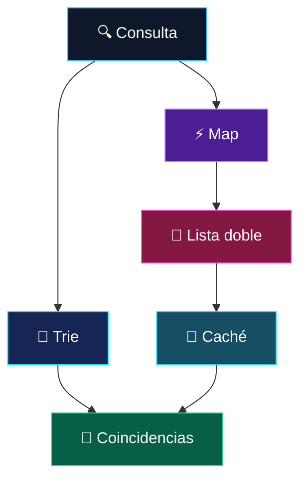
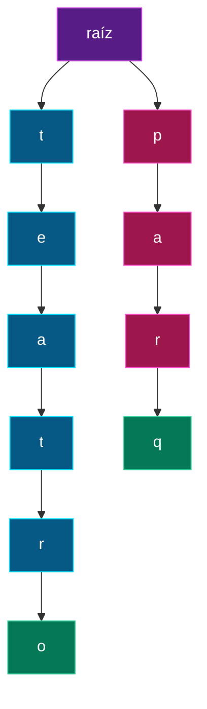
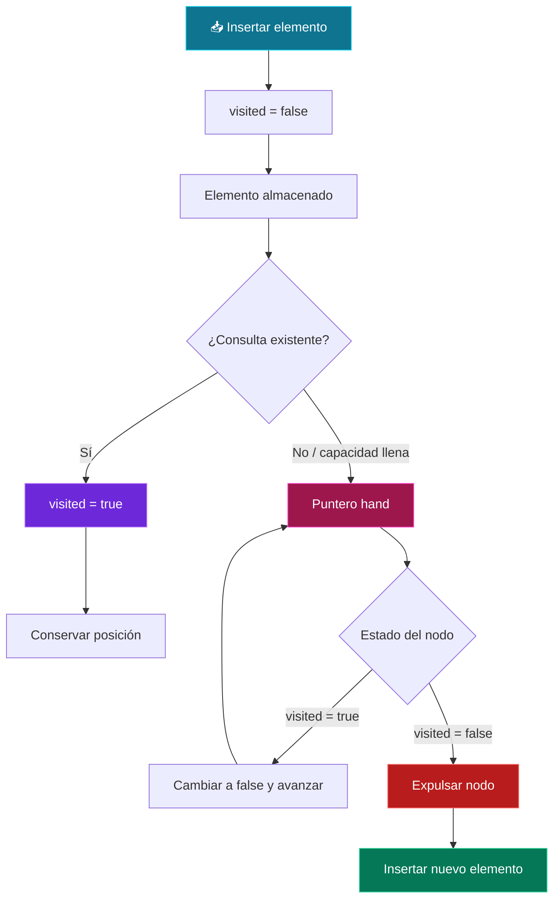
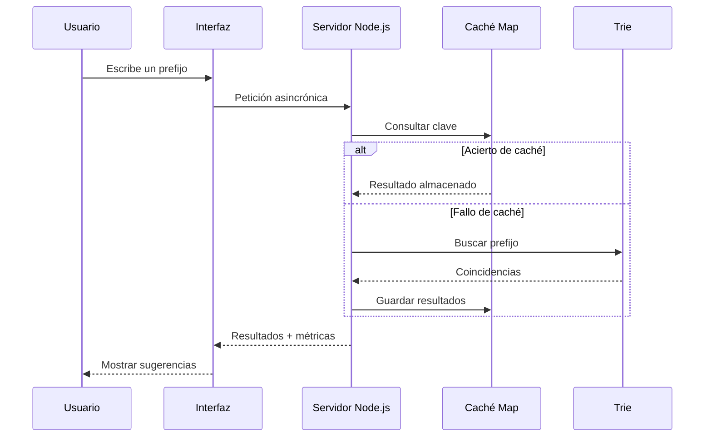

<div align="center">


# UNIVERSIDAD NACIONAL DE LOJA

### Carrera de Computación · Tercer Ciclo

<br/>


### **Sistema de Autocompletado Cultural del FIAVL**


<br/>

<em>La velocidad de búsqueda se encuentra con la inteligencia de las estructuras de datos.</em>

<br/><br/>


<br/>

<kbd> NODE.JS </kbd> · <kbd> EXPRESS </kbd> · <kbd> JAVASCRIPT </kbd> · <kbd> TRIE </kbd> · <kbd> SIEVE </kbd>

<br/><br/>

<font color="#38BDF8">●</font> **GRUPO 4** &nbsp; <font color="#A855F7">●</font> **ESTRUCTURA DE DATOS** &nbsp; <font color="#F472B6">●</font> **2026–2027**

</div>

---

# 🟣 01 · EL PROYECTO

<details open>
<summary><b>▸ Identidad y propósito</b></summary>

<br/>

**Loja Cultura Pulse** es un sistema de autocompletado enfocado en la búsqueda de información turística y cultural relacionada con el Festival Internacional de Artes Vivas de Loja (FIAVL).

El proyecto combina estructuras de datos no lineales y algoritmos de gestión de memoria para ofrecer sugerencias de búsqueda en tiempo real, reducir operaciones repetitivas y optimizar la recuperación de información.

Su funcionamiento se fundamenta en un árbol de prefijos **Trie**, un índice dinámico basado en **Map** y un sistema de caché que permite comparar diferentes estrategias de reemplazo de elementos.

</details>

<div align="center">

|  |  |  |
|:---:|:---:|:---:|
| Búsqueda por prefijos | Gestión de memoria | Medición en milisegundos |

</div>

<div align="center">


<sub>Figura 1. Interfaz principal del sistema de autocompletado cultural.</sub>

</div>

---

# 🔵 02 · INTERFAZ Y EXPERIENCIA DE BÚSQUEDA

La interfaz permite al usuario ingresar el nombre de un lugar, evento o referencia cultural para obtener sugerencias de forma dinámica, sin necesidad de escribir el término completo.

### ✦ Características de interacción

- 🔹 Búsqueda mientras se escribe.
- 🔹 Autocompletado de nombres.
- 🔹 Recuperación de coincidencias mediante prefijos.
- 🔹 Procesamiento de consultas en el servidor.
- 🔹 Respuestas asincrónicas desde la interfaz.
- 🔹 Visualización del estado de funcionamiento.

<div align="center">


<sub>Figura 2. Consulta dinámica de lugares y referencias culturales.</sub>

</div>

### ◈ Ejemplo de búsqueda

```text
┌─────────────────────────────────────────────────────────┐
│  🔎  Escribe un lugar, obra o evento...              │
└─────────────────────────────────────────────────────────┘

Entrada:  tea

             ↓

Resultados sugeridos:

   ▸ Teatro Bolívar
   ▸ Teatro Municipal
   ▸ Teatro Benjamín Carrión
```

<sub>Ejemplo ilustrativo de sugerencias; los resultados dependen del catálogo cargado.</sub>

---

# 🟢 03 · ARQUITECTURA Y ESTRUCTURAS

El núcleo del sistema se construye a partir de tres componentes principales, cada uno con una responsabilidad específica dentro de la recuperación y administración de consultas.

<div align="center">


</div>

| Estructura | Función dentro del sistema | Complejidad |
|---|---|---|
| 🌳 **Trie** | Organiza el catálogo por caracteres compartidos y recupera coincidencias de prefijos. | O(L) para recorrer el prefijo |
| ⚡ **Map (Tabla Hash)** | Localiza las claves de consulta y referencias a nodos de caché. | O(1) promedio |
| 🔗 **Lista doblemente enlazada** | Administra los nodos de memoria mediante referencias `prev` y `next`. | O(1) para operaciones locales con referencias |

### ◈ Relación entre componentes



<div align="center">


<sub>Figura 3. Interacción entre el Trie, la tabla Hash y la lista doblemente enlazada.</sub>

</div>

---

# 🟠 04 · ÁRBOL DE PREFIJOS (TRIE)

<details open>
<summary><b>▸ Organización y recuperación de coincidencias</b></summary>

<br/>

El Trie es una estructura de datos no lineal que organiza cadenas mediante caracteres compartidos. Cada nodo representa una parte de la palabra y permite avanzar por una secuencia de caracteres hasta localizar el prefijo consultado.

Esta estructura evita tener que comparar individualmente cada nombre del catálogo para determinar si coincide con la entrada del usuario.

</details>

### ◈ Ejemplo de estructura



### ◈ Análisis de búsqueda

| Operación | Descripción |
|---|---|
| Inserción | Incorpora caracteres y crea nodos cuando no existen. |
| Recorrido | Avanza por los caracteres de la consulta. |
| Prefijo | Localiza el nodo correspondiente a la cadena ingresada. |
| Recuperación | Obtiene las coincidencias descendientes del nodo localizado. |

<blockquote>

<font color="#00D9FF">**Complejidad de recorrido: O(L)**</font>

Donde `L` representa la longitud del prefijo ingresado, sin considerar el costo de enumerar todos los resultados encontrados.

</blockquote>

<div align="center">


<sub>Figura 4. Representación gráfica de la búsqueda a través de caracteres compartidos.</sub>

</div>

---

# 🩷 05 · SISTEMA DE CACHÉ Y POLÍTICAS DE REEMPLAZO

El sistema utiliza memoria caché para conservar consultas y reducir la necesidad de repetir búsquedas. Su capacidad es limitada, por lo que requiere políticas que determinen qué elementos deben mantenerse y cuáles deben eliminarse.

<div align="center">


</div>

### ◈ Comparación de políticas

| Política | Estrategia | Comportamiento |
|---|---|---|
| 🟠 **FIFO** | Primero en entrar, primero en salir | Expulsa el elemento más antiguo sin considerar las consultas repetidas. |
| 🟣 **LRU** | Menos recientemente utilizado | Reorganiza nodos ante los aciertos y elimina el elemento menos reciente. |
| 🔵 **SIEVE** | Marcado y barrido | Utiliza un estado de visita y un puntero de recorrido para gestionar la expulsión. |

### ◈ ¿Por qué SIEVE?

SIEVE utiliza un mecanismo de promoción perezosa: cuando un elemento es consultado, se marca como visitado sin reorganizar físicamente su nodo.

Esto reduce las operaciones de reordenamiento que se producen en políticas como LRU.

<div align="center">


<sub>Figura 5. Administración de elementos y mecanismo de barrido de SIEVE.</sub>

</div>

### 🔹 Funcionamiento de SIEVE



---

# 🟡 06 · FLUJO DE EJECUCIÓN Y RENDIMIENTO

El controlador central coordina la interfaz, las peticiones del servidor y las estructuras de datos, permitiendo que cada consulta se procese a través de una ruta de recuperación optimizada.

### ◈ Secuencia de procesamiento



### ◈ Evaluación de rendimiento

El sistema permite observar las operaciones de consulta y analizar las diferencias entre las políticas de memoria.

| Indicador | Utilidad |
|---|---|
| ⏱️ Tiempo de respuesta | Medir la duración de la operación. |
| 🟢 Aciertos | Cuantificar consultas recuperadas desde caché. |
| 🔴 Fallos | Identificar consultas que requieren procesamiento. |
| 📦 Tamaño de caché | Observar la ocupación de memoria lógica. |
| ♻️ Expulsiones | Analizar la renovación de elementos almacenados. |
| 📈 Rendimiento | Comparar políticas bajo una misma secuencia de consultas. |

<div align="center">


<sub>Figura 6. Comparativa de rendimiento de FIFO, LRU y SIEVE.</sub>

</div>

---

# 🧬 07 · EVIDENCIAS Y EVOLUCIÓN

### ◈ Galería de desarrollo

<div align="center">

| 🔷 Interfaz | 🟣 Procesamiento |
|:---:|:---:|
|  |  |
| <sub>Figura 7. Buscador</sub> | <sub>Figura 8. Servidor</sub> |

| 🟢 Estructuras | 🩷 Experimentación |
|:---:|:---:|
|  |  |
| <sub>Figura 9. Estructuras</sub> | <sub>Figura 10. Evaluación</sub> |

</div>

### ◈ Estado de desarrollo

| Componente | Estado |
|---|:---:|
| Autocompletado con Trie | 🟢 |
| Servidor Node.js y Express | 🟢 |
| Índice mediante Map | 🟢 |
| Lista doblemente enlazada | 🟢 |
| Política FIFO | 🟢 |
| Política LRU | 🟢 |
| Política SIEVE | 🟢 |
| Búsquedas por prefijos | 🟢 |
| Métricas de consultas | 🟢 |
| Mejoras visuales de interfaz | 🟡 |
| Experimentos y comparativas ampliadas | 🟡 |

<sub>🟢 Implementado · 🟡 En mejora o validación · ⚪ Pendiente</sub>

### ◈ Instalación y ejecución

```bash
# Clonar el repositorio
git clone URL_DEL_REPOSITORIO

# Acceder a la carpeta
cd NOMBRE_DEL_PROYECTO

# Instalar dependencias
npm install

# Ejecutar
npm start
```

<details>
<summary><b>📌 Requisitos del entorno</b></summary>

- Node.js
- npm
- Navegador web actualizado
- Git

</details>

---

# 🔴 08 · EQUIPO Y CRÉDITOS

<div align="center">


<br/>

### 👨‍🏫 Docente

**Ing. Cristian Narvaez**

<br/>

### 👨‍💻 Integrantes

**Yimmy Onner Angulo Torres**  
**Richard Santiago Guaman Sanchez**  
**Freddy Alexander Ordoñez Gonzalez**  
**Joaquin Emilio Moscol Castillo**  
**Erick Jahirs Rogel Baque**

<br/>

### 📚 Carrera de Computación · Tercer Ciclo

**Período académico**  
Septiembre 2026 – Febrero 2027

<br/>


<br/>

<font color="#00D9FF">━━━━━━━━━━━━━━━━━━━━━━━━━━━━━━━━</font>

### **LOJA CULTURA PULSE**

<font color="#BC13FE">Estructuras de Datos · Algoritmos · Innovación</font>

*Loja, Ecuador · 2026*

<font color="#FF3CAC">━━━━━━━━━━━━━━━━━━━━━━━━━━━━━━━━</font>

</div>
