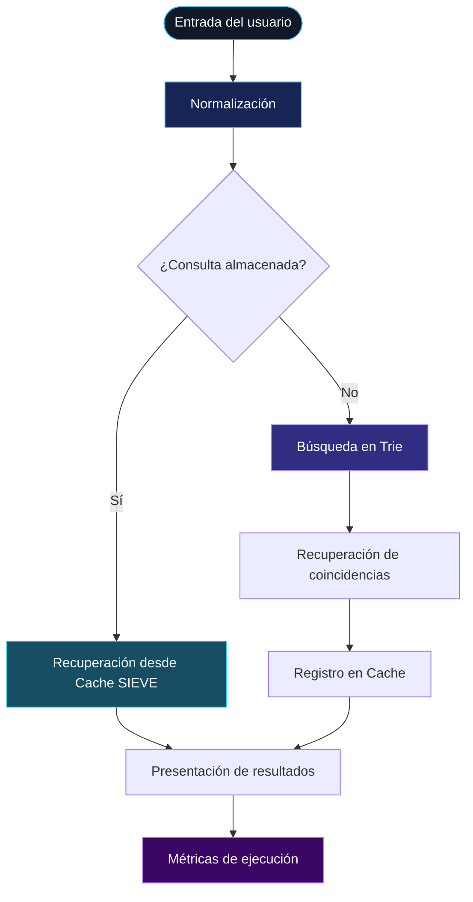
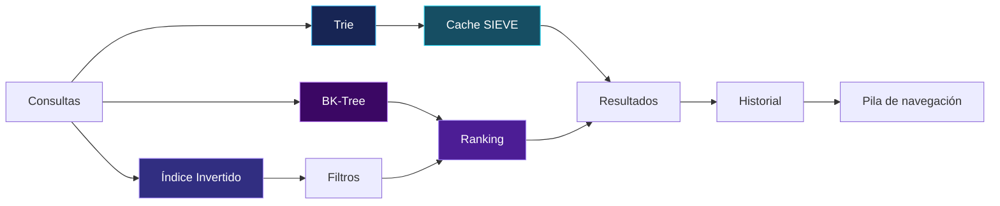
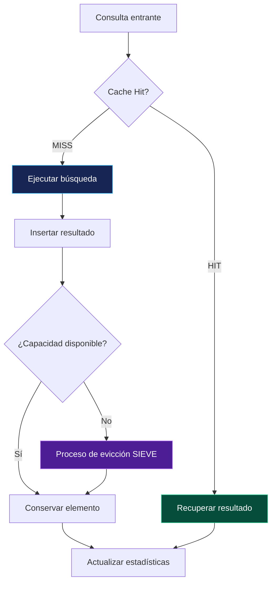
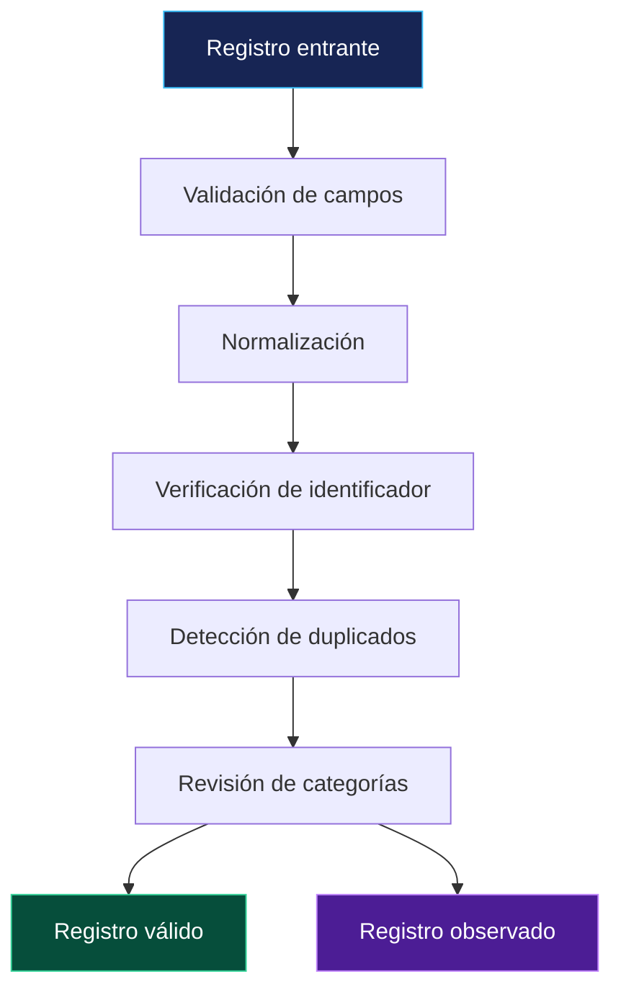
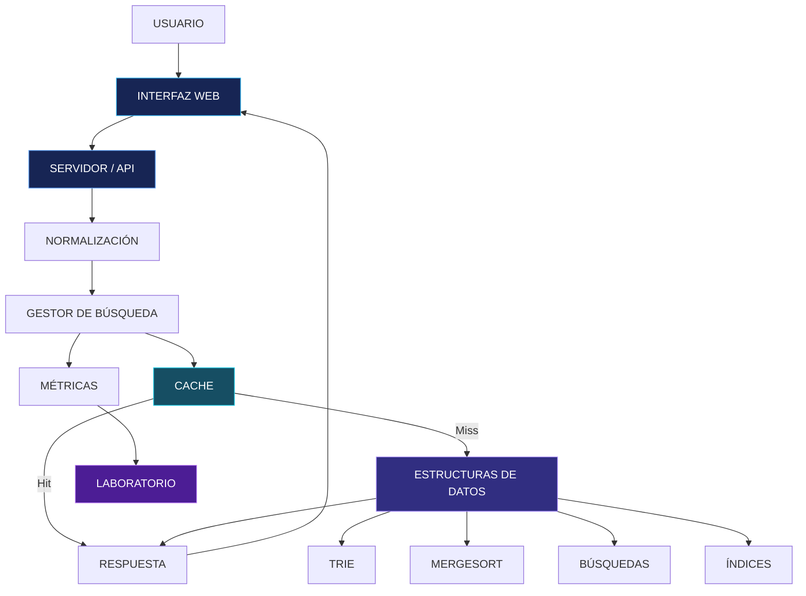
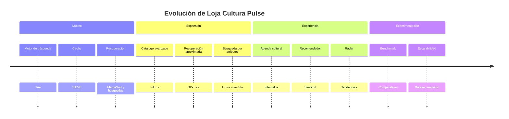

 <div align="center">


# **UNIVERSIDAD NACIONAL DE LOJA**

### *Carrera de Computación · Tercer Ciclo*

<br>


### *INTELLIGENT CULTURAL DISCOVERY SYSTEM*


<br>

> **Explora lo desconocido. Encuentra lo extraordinario.**

<br>

[](https://developer.mozilla.org/es/docs/Web/JavaScript)
[](https://nodejs.org/)
[](https://expressjs.com/)
[](#-núcleo-algorítmico)
[](#-roadmap-de-evolución)

<br>

### 👨‍🏫 DOCENTE
**Ing. Cristian Narvaez**

### ◈ GRUPO 4 ◈

**Yimmy Onner Angulo Torres**  
**Richard Santiago Guaman Sanchez**  
**Freddy Alexander Ordoñez Gonzalez**  
**Joaquin Emilio Moscol Castillo**  
**Erick Jahirs Rogel Baque**

<br>

### 📡 PERÍODO ACADÉMICO
**Septiembre 2026 — Febrero 2027**

</div>

---

<div align="center">

# `01` / SYSTEM OVERVIEW

</div>

## ◈ Una nueva forma de explorar la cultura

**Loja Cultura Pulse** es una propuesta de sistema inteligente orientado a la búsqueda, exploración y descubrimiento de información cultural, artística y turística vinculada al Festival Internacional de Artes Vivas de Loja.

La plataforma busca transformar la manera en que un visitante encuentra experiencias, permitiendo consultar información mediante prefijos, recuperar resultados de forma eficiente, explorar diferentes categorías y descubrir alternativas que podrían pasar desapercibidas en una búsqueda convencional.

Su núcleo está construido alrededor de estructuras de datos y algoritmos desarrollados para estudiar el comportamiento de las consultas, optimizar la recuperación de información y analizar el rendimiento de diferentes estrategias de procesamiento.

<div align="center">


<sub>Figura 01. Concepto visual de la plataforma de exploración cultural.</sub>

</div>

---

<div align="center">

## `02` / THE EXPERIENCE

### El visitante. La consulta. El descubrimiento.

</div>

El sistema no está pensado para que el visitante conozca previamente todos los nombres del catálogo. La idea es que pueda comenzar con una palabra, una categoría o una referencia parcial y avanzar progresivamente hacia una experiencia de su interés.

<details>
<summary><b>◉ Exploración instantánea</b></summary>

El usuario escribe una consulta y recibe coincidencias sin necesidad de completar el nombre de un evento, lugar u obra.

</details>

<details>
<summary><b>◉ Recuperación inteligente</b></summary>

El motor aprovecha estructuras especializadas para localizar coincidencias y reutilizar resultados previamente procesados.

</details>

<details>
<summary><b>◉ Descubrimiento cultural</b></summary>

La plataforma busca evolucionar hacia filtros, recomendaciones y mecanismos que permitan encontrar experiencias más allá de una coincidencia textual exacta.

</details>

<details>
<summary><b>◉ Exploración analítica</b></summary>

El usuario y el equipo de desarrollo podrán observar métricas de consulta y evaluar el comportamiento de los algoritmos que intervienen en el procesamiento.

</details>

---

<div align="center">

## `03` / SEARCH INTERFACE

### El punto de entrada al sistema

</div>

El buscador constituye el núcleo de interacción entre el usuario y el catálogo cultural. Su funcionamiento se basa en la consulta dinámica y en la recuperación progresiva de resultados mediante prefijos.

### Funcionalidades del buscador

| ID | Capacidad | Descripción |
|:---:|---|---|
| S-01 | Autocompletado | Genera sugerencias mientras se escribe. |
| S-02 | Prefijos | Recupera registros a partir de una cadena inicial. |
| S-03 | Normalización | Reduce diferencias de escritura y formato. |
| S-04 | Consulta dinámica | Actualiza las coincidencias durante la entrada de texto. |
| S-05 | Cache de consultas | Reutiliza resultados almacenados. |
| S-06 | Métricas | Expone información de la ejecución. |
| S-07 | Ordenamiento | Organiza resultados mediante algoritmos implementados. |
| S-08 | Búsqueda alternativa | Propuesta de recuperación aproximada para consultas sin coincidencia. |

<div align="center">


<sub>Figura 02. Interfaz de búsqueda dinámica y recuperación de coincidencias.</sub>

</div>

### ◈ Flujo de una consulta



---

<div align="center">

# `04` / BEYOND THE SEARCH

### Capacidades que queremos incorporar

</div>

El objetivo de evolución del sistema es convertir el autocompletado en una herramienta de exploración cultural más completa. Estas funciones representan extensiones propuestas que se desarrollarán progresivamente.

### `01` — Recuperación tolerante a errores

Encontrar nombres similares incluso cuando la consulta contiene errores ortográficos, caracteres incorrectos o palabras incompletas que no producen una coincidencia exacta.

**Ejemplo:**

```text
Entrada: Vilcabnaba

        ↓ Recuperación aproximada

Posible coincidencia:
Vilcabamba
```

**Tecnología propuesta:** BK-Tree, Distancia de Levenshtein y ranking de similitud.

---

### `02` — Índice multidimensional de contenido

Buscar en diferentes atributos del catálogo sin depender únicamente del nombre principal del registro.

```text
Consulta: "teatro"

Coincidencias en:
├── Nombre
├── Descripción
├── Categoría
├── Artistas
├── Ubicación
└── Palabras clave
```

**Tecnología propuesta:** Índice invertido, HashMap y conjuntos de resultados.

---

### `03` — Agenda temporal de experiencias

Permitir que el visitante seleccione diferentes actividades y consulte si los horarios son compatibles.

- Selección de eventos.
- Orden cronológico.
- Consulta de disponibilidad temporal en el dataset.
- Detección de actividades simultáneas.
- Identificación de intervalos libres.
- Organización de una agenda personal.

**Tecnología propuesta:** Ordenamiento por intervalos, estructuras temporales y Árbol de Intervalos (Interval Tree).

<div align="center">


<sub>Figura 03. Concepto de planificación temporal de actividades.</sub>

</div>

---

### `04` — Sistema de afinidad cultural

Crear recomendaciones basadas en características compartidas entre eventos, categorías, ubicaciones, artistas y palabras clave.

El sistema podría asignar puntuaciones a los resultados para ordenar las alternativas según el grado de similitud.

**Tecnología propuesta:**

- Similitud de atributos.
- Ponderación de características.
- Conjuntos de palabras clave.
- Ranking de coincidencias.

---

### `05` — Radar de actividad cultural

Analizar las consultas realizadas para identificar patrones de interés.

| Indicador | Propósito |
|---|---|
| Consulta más frecuente | Identificar el término dominante. |
| Categoría más explorada | Analizar preferencias generales. |
| Búsquedas sin resultados | Detectar oportunidades de mejora del catálogo. |
| Consultas nuevas | Observar términos no registrados previamente. |
| Tendencia de consultas | Analizar cambios entre períodos. |

**Tecnología propuesta:** HashMap, contadores de frecuencia y ventanas temporales.

---

### `06` — Descubrimiento fuera del ranking

Una función orientada a explorar registros que no necesariamente son los más populares.

En lugar de mostrar siempre los resultados con mayor frecuencia, el sistema podría priorizar registros poco consultados que coincidan con los intereses del visitante.

> El objetivo es diversificar el descubrimiento y evitar que las mismas experiencias aparezcan constantemente.

**Tecnología propuesta:** métricas de popularidad, puntuación de exploración y selección ponderada.

---

### `07` — Comparador de experiencias

Permitir seleccionar varias actividades y visualizar sus diferencias.

| Criterio | Evento A | Evento B | Evento C |
|---|---|---|---|
| Categoría | [Dato] | [Dato] | [Dato] |
| Ubicación | [Dato] | [Dato] | [Dato] |
| Fecha | [Dato] | [Dato] | [Dato] |
| Duración | [Dato] | [Dato] | [Dato] |
| Palabras clave | [Dato] | [Dato] | [Dato] |

**Tecnología propuesta:** selección de registros, filtros multicriterio y comparación estructurada.

---

### `08` — Diagnóstico del catálogo

Una herramienta para revisar la consistencia de los datos antes de utilizar el catálogo en búsquedas y experimentos.

- Registros duplicados.
- Identificadores repetidos.
- Datos incompletos.
- Categorías inválidas.
- Nombres inconsistentes.
- Fechas mal formadas.
- Registros sin palabras clave.

**Tecnología propuesta:** HashMap, Set, normalización y validadores.

---

<div align="center">

# `05` / ALGORITHMIC CORE

### Estructuras que impulsan el sistema

</div>

Cada estructura de datos se integra con una responsabilidad concreta. El propósito es evitar implementaciones decorativas y aprovecharlas en operaciones que realmente requieren sus características.

<table>
<thead>
<tr>
<th>ESTRUCTURA</th>
<th>APLICACIÓN</th>
<th>OPERACIÓN CLAVE</th>
</tr>
</thead>
<tbody>
<tr>
<td><b>Trie</b></td>
<td>Autocompletado por prefijos</td>
<td>Recorrido de caracteres</td>
</tr>
<tr>
<td><b>Lista doblemente enlazada</b></td>
<td>Administración de nodos de caché</td>
<td>Inserción / eliminación</td>
</tr>
<tr>
<td><b>HashMap</b></td>
<td>Acceso directo, índices y frecuencias</td>
<td>Consulta por clave</td>
</tr>
<tr>
<td><b>BK-Tree</b></td>
<td>Recuperación de términos similares</td>
<td>Distancia de edición</td>
</tr>
<tr>
<td><b>Índice invertido</b></td>
<td>Consulta por atributos y palabras</td>
<td>Intersección de postings</td>
</tr>
<tr>
<td><b>Interval Tree</b></td>
<td>Consulta de eventos por tiempo</td>
<td>Intersección de intervalos</td>
</tr>
<tr>
<td><b>Set / Bitset</b></td>
<td>Filtros combinados y selección</td>
<td>Unión / intersección</td>
</tr>
<tr>
<td><b>Pila</b></td>
<td>Navegación y estados anteriores</td>
<td>Push / Pop</td>
</tr>
</tbody>
</table>

### ◈ Mapa de responsabilidades



---

<div align="center">

# `06` / MEMORY PROTOCOL

### Cache SIEVE · Reutilización inteligente

</div>

La caché permite conservar consultas y resultados para reducir el trabajo repetitivo de recuperación. Su administración se apoya en una lista doblemente enlazada y en la política SIEVE.

### ¿Qué ocurre en memoria?



### Métricas de observación

<div align="center">


<sub>Figura 04. Panel de administración y estadísticas de memoria.</sub>

</div>

| Métrica | Descripción |
|---|---|
| `Hits` | Consultas recuperadas desde la caché. |
| `Misses` | Consultas que requieren recuperación. |
| `Hit Rate` | Proporción de consultas atendidas desde caché. |
| `Cache Size` | Elementos almacenados actualmente. |
| `Capacity` | Límite de elementos permitido. |
| `Evictions` | Elementos expulsados. |
| `Latency` | Tiempo de respuesta medido. |

### ◈ Políticas bajo comparación

| Política | Principio de funcionamiento |
|---|---|
| FIFO | Expulsión según orden de entrada. |
| LRU | Conservación según uso reciente. |
| SIEVE | Administración de elementos mediante marcas de visita y recorrido de expulsión. |

El módulo de experimentación permitirá comparar el comportamiento de estas políticas utilizando las mismas secuencias de consulta, tamaños de caché y condiciones de ejecución.

---

<div align="center">

# `07` / PERFORMANCE LAB

### Medir. Comparar. Interpretar.

</div>

El Laboratorio de Rendimiento será el espacio dedicado a estudiar el comportamiento de los algoritmos mediante ejecuciones controladas.

En lugar de asumir que una estructura es más eficiente únicamente por su complejidad teórica, se busca observar cómo responde bajo distintos tamaños de datos y patrones de acceso.

### Banco de experimentos

| Escenario | Objetivo |
|---|---|
| Catálogo reducido | Analizar el comportamiento con pocos registros. |
| Catálogo intermedio | Observar el crecimiento del tiempo de ejecución. |
| Catálogo ampliado | Evaluar escalabilidad. |
| Consultas repetidas | Medir la reutilización de caché. |
| Consultas aleatorias | Analizar accesos dispersos. |
| Consultas inexistentes | Estudiar fallos de recuperación. |
| Prefijos cortos | Evaluar cantidad de coincidencias. |
| Prefijos largos | Evaluar recuperación más específica. |

### Variables registradas

- Tiempo de ejecución.
- Número de comparaciones.
- Número de operaciones.
- Variabilidad de las muestras.
- Tamaño de entrada.
- Memoria aproximada.
- Porcentaje de reutilización de caché.

<div align="center">


<sub>Figura 05. Comparación experimental de algoritmos.</sub>

</div>

### Comparativas previstas

| Comparación | Pregunta experimental |
|---|---|
| Trie vs búsqueda secuencial | ¿Qué ventaja aporta el índice de prefijos? |
| Búsqueda binaria vs secuencial | ¿Cómo cambia el tiempo sobre datos ordenados? |
| Cache SIEVE vs FIFO | ¿Cómo afecta la política de expulsión a los hits? |
| Cache SIEVE vs LRU | ¿Qué comportamiento presentan ante consultas repetidas? |
| MergeSort vs referencia nativa | ¿Cómo se comportan los métodos al ordenar datasets crecientes? |
| BK-Tree vs búsqueda completa por similitud | ¿Qué impacto tiene la recuperación aproximada? |

> Los resultados, gráficas y conclusiones se incorporarán después de ejecutar los experimentos. No se utilizarán valores simulados como resultados finales.

---

<div align="center">

# `08` / DATA INTELLIGENCE

### El catálogo también forma parte del algoritmo

</div>

La calidad de los resultados depende tanto de las estructuras implementadas como de la organización de los datos.

Por ello, el catálogo cultural debe contar con un formato consistente, que permita indexar los registros, generar sugerencias y aplicar filtros.

### Modelo de registro propuesto

```json
{
  "id": "EVT-001",
  "nombre": "Nombre del evento",
  "categoria": "Teatro",
  "tipo": "Presentacion",
  "ubicacion": "Loja, Ecuador",
  "fecha": "2026-11-25",
  "descripcion": "Descripción de la experiencia",
  "palabrasClave": [
    "arte",
    "escena",
    "cultura"
  ]
}
```

<sub>Ejemplo ilustrativo de formato de registro; no corresponde a un evento confirmado.</sub>

### Control de calidad



---

<div align="center">

# `09` / SYSTEM ARCHITECTURE

### Separación de responsabilidades

</div>

La arquitectura se organiza para separar la interfaz de usuario, el procesamiento de peticiones, las estructuras de datos, la administración de caché y el módulo experimental.



### Stack tecnológico

<div align="center">

[](https://developer.mozilla.org/es/docs/Web/JavaScript)
[](https://nodejs.org/)
[](https://expressjs.com/)
[](https://developer.mozilla.org/es/docs/Web/HTML)
[](https://developer.mozilla.org/es/docs/Web/CSS)
[](https://git-scm.com/)

</div>

| Tecnología | Utilización |
|---|---|
| JavaScript | Implementación de estructuras y algoritmos. |
| Node.js | Entorno de ejecución del servidor. |
| Express | API y administración de solicitudes. |
| HTML | Estructura de la interfaz. |
| CSS | Diseño visual y sistema de estilos. |
| JSON | Representación de datos. |
| Git | Control de versiones y trabajo colaborativo. |
| Chart.js *(incorporación prevista)* | Visualización de métricas. |

---

<div align="center">

# `10` / VISUAL ARCHIVE

### Una mirada al sistema

</div>

<details>
<summary><b>◈ Main Interface — Buscador</b></summary>

<br>


</details>

<details>
<summary><b>◈ Search Results — Resultados</b></summary>

<br>


</details>

<details>
<summary><b>◈ Memory Monitor — Caché</b></summary>

<br>


</details>

<details>
<summary><b>◈ Algorithm Lab — Benchmark</b></summary>

<br>


</details>

<details>
<summary><b>◈ Cultural Explorer — Explorador</b></summary>

<br>


</details>

---

<div align="center">

# `11` / DEVELOPMENT ROADMAP

### Evolución de Pulse

</div>

El desarrollo se plantea de manera incremental, preservando las implementaciones actuales y añadiendo nuevas capacidades mediante módulos independientes.

| Fase | Objetivo | Estado |
|:---:|---|:---:|
| 01 | Motor Trie y autocompletado | 🟢 Base implementada |
| 02 | Cache SIEVE y lista doble | 🟢 Base implementada |
| 03 | MergeSort y métodos de búsqueda | 🟢 Base implementada |
| 04 | Mejoras de interfaz y catálogo | 🟡 Evolución |
| 05 | Búsqueda aproximada BK-Tree | ⚪ Planificado |
| 06 | Índice invertido multicampo | ⚪ Planificado |
| 07 | Agenda y detección de conflictos | ⚪ Planificado |
| 08 | Sistema de afinidad cultural | ⚪ Planificado |
| 09 | Radar de tendencias | ⚪ Planificado |
| 10 | Laboratorio comparativo ampliado | ⚪ Planificado |

### Visión de desarrollo



---

<div align="center">

# `12` / DEPLOYMENT

### Ejecuta el entorno local

</div>

## Requisitos

- Node.js instalado.
- npm.
- Navegador actualizado.
- Git recomendado.

### Clonar el repositorio

```bash
git clone URL_DEL_REPOSITORIO
```

### Ingresar al proyecto

```bash
cd NOMBRE_DEL_PROYECTO
```

### Instalar dependencias

```bash
npm install
```

### Ejecutar el servidor

```bash
npm start
```

### Ejecutar pruebas

```bash
npm test
```

### Ejecutar benchmarking

```bash
npm run benchmark
```

> Los comandos se ajustarán a los scripts reales definidos en `package.json`.

---

<div align="center">

# `13` / TECHNICAL EVIDENCE

### Validación y experimentación

</div>

El funcionamiento de las estructuras y algoritmos debe validarse mediante pruebas que permitan comprobar la exactitud de los resultados y su comportamiento bajo diferentes escenarios.

### Validaciones previstas

- Coincidencias correctas en Trie.
- Prefijos inexistentes.
- Prefijos con múltiples resultados.
- Normalización de consultas.
- Inserción y recuperación de caché.
- Evicción cuando se alcanza la capacidad.
- Ordenamiento de datos.
- Búsqueda en registros ordenados.
- Consultas repetidas y nuevas.
- Consistencia entre los algoritmos y sus resultados.

### Registro de experimentos

| ID | Experimento | Tamaño | Resultado |
|---|---|---:|---|
| EXP-01 | Búsqueda por prefijo | [N] | [Pendiente] |
| EXP-02 | Búsqueda secuencial | [N] | [Pendiente] |
| EXP-03 | Búsqueda binaria | [N] | [Pendiente] |
| EXP-04 | MergeSort | [N] | [Pendiente] |
| EXP-05 | Cache SIEVE | [N] | [Pendiente] |
| EXP-06 | Comparación de políticas | [N] | [Pendiente] |

<div align="center">


<sub>Figura 06. Evidencia de validación y evaluación experimental.</sub>

</div>

---

<div align="center">

# `14` / PROJECT BOUNDARIES

### Alcance y limitaciones

</div>

- La calidad de las coincidencias depende del contenido y consistencia del catálogo.
- Los resultados experimentales dependen del hardware y del entorno de ejecución.
- La normalización puede alterar diferencias semánticas si no se define correctamente.
- Las recomendaciones requieren suficientes atributos descriptivos.
- La agenda depende de la disponibilidad y precisión de fechas y horarios.
- Las funciones en planificación no forman parte de las capacidades operativas hasta completar su desarrollo.
- El proyecto se centra en la aplicación de estructuras de datos y algoritmos al descubrimiento de información cultural.

---

<div align="center">

# `15` / CONTRIBUTORS

### Grupo 4 · Desarrollo académico

</div>

<table>
<thead>
<tr>
<th>Integrante</th>
<th>Participación</th>
</tr>
</thead>
<tbody>
<tr>
<td>Yimmy Onner Angulo Torres</td>
<td>Desarrollo e integración</td>
</tr>
<tr>
<td>Richard Santiago Guaman Sanchez</td>
<td>Desarrollo e integración</td>
</tr>
<tr>
<td>Freddy Alexander Ordoñez Gonzalez</td>
<td>Desarrollo e integración</td>
</tr>
<tr>
<td>Joaquin Emilio Moscol Castillo</td>
<td>Desarrollo e integración</td>
</tr>
<tr>
<td>Erick Jahirs Rogel Baque</td>
<td>Desarrollo e integración</td>
</tr>
</tbody>
</table>

### Información académica

| Campo | Información |
|---|---|
| Institución | Universidad Nacional de Loja |
| Carrera | Computación |
| Ciclo | Tercer Ciclo |
| Asignatura | Estructura de Datos |
| Docente | Ing. Cristian Narvaez |
| Grupo | 4 |
| Período | Septiembre 2026 – Febrero 2027 |

---

<div align="center">

# `16` / ACKNOWLEDGEMENTS

### Tecnología al servicio de la cultura.

Loja Cultura Pulse nace como una iniciativa académica para explorar la aplicación práctica de estructuras de datos, algoritmos y técnicas de recuperación de información dentro de una experiencia digital orientada a la cultura y el arte.

Su desarrollo busca demostrar que el estudio de la eficiencia algorítmica puede trascender los ejercicios teóricos y convertirse en herramientas capaces de organizar, recuperar y conectar información útil para las personas.

<br>


### **LOJA CULTURA PULSE**

<sub>Explore the signal. Discover the culture.</sub>

<br>

**Universidad Nacional de Loja · Grupo 4**

*Loja, Ecuador · 2026*

</div>
